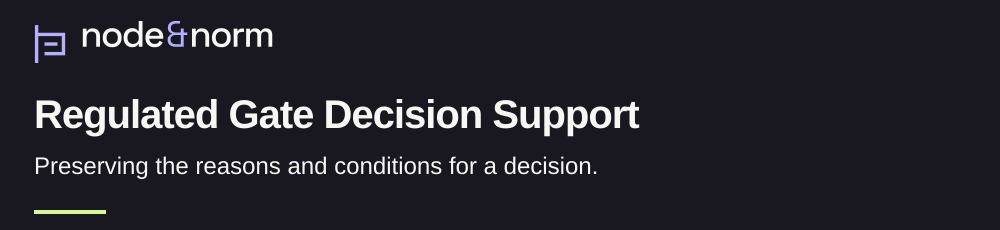
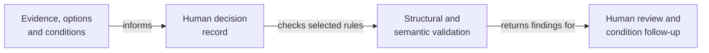

<h1>
<picture>
  <source media="(max-width: 600px)" srcset="assets/research/v1/banner-mobile-dark.svg">
  
</picture>
</h1>

[](docs/research-summary.md) [](CITATION.cff) [](LICENSE)

Why did a team proceed, stop or wait? Regulated Gate Decision Support (RGDS) records the evidence, authority and unresolved conditions behind a phase-gate decision, a checkpoint where people decide whether work may advance. [Research question](docs/research-summary.md).

[Policy reader: understand in 90 seconds](#research-in-90-seconds) · [Reviewer: inspect evidence and limits](docs/current-review.md) · [Engineer: run the checks](docs/reference-verification.md)

## At a glance

| | Current account |
| :--- | :--- |
| Purpose | Preserve permission, unresolved conditions and required closure evidence. [Research account](docs/research-summary.md) |
| Status | Reference implementation. Institutional evaluation remains prospective. [Evaluation plan](evaluation/evaluation-plan.md) |
| Evidence type | Six authored illustrative records and software regression checks. [Examples](examples/) · [tests](tests/test_validation.py) |
| Version | Implementation 2.0.1, September 9, 2026. [Citation metadata](CITATION.cff) · [release note](docs/releases/v2.0.1.md) |
| License | Declared Apache-2.0. [Preserved license](LICENSE) · [attribution](NOTICE) |
| Cite | Cite the implementation and record its Git commit. The related study has a separate DOI. [Citation guide](docs/citation-provenance.md) |

The repository supplies reference structure and selected consistency checks. Deployment outcomes, faster decisions and regulatory benefit remain unmeasured. [Evidence boundary](docs/research-summary.md#limits-and-next-evidence), [prospective evaluation](evaluation/evaluation-plan.md).

## Research in 90 seconds

A conditional approval leaves work to complete. Someone must own each condition, know what evidence will close it and preserve the basis for deciding that work may continue. RGDS makes those elements explicit in a decision record. [Decision-log guide](docs/decision-log.md), [research account](docs/research-summary.md).

The method combines a data contract with structural and semantic checks. Structural checks test the required shape of the record. Semantic checks test selected relationships, such as whether conditional permission includes conditions and whether AI-assisted preparation includes review fields. People retain responsibility for the decision and its substance. [Schema](decision-log/decision-log.schema.json), [shared validator](scripts/validate_decision_log.py), [AI-assistance policy](docs/ai-assistance-policy.md).

The six canonical examples include four conditional approvals, one refusal and one deferral requiring evidence. They are authored illustrations. Their contents provide no observation of a completed institutional decision or approval. [Example inventory](docs/current-review.md#the-six-illustrative-records), [research limits](docs/research-summary.md#limits-and-next-evidence).

## Method in brief



The text sequence is: prepare the evidence and options, record the human decision, run the checks, then review the substance and follow up on conditions. The validators return findings. A policy or an approval field alone leaves actual review unconfirmed. [Validator](scripts/validate_decision_log.py), [AI-use and verification limits](docs/ai-use-disclosure.md).

## Evidence and known limits

| Material | What is available | What remains open |
| :--- | :--- | :--- |
| Decision contract | JSON and YAML schema plus six illustrative records. [Schema](decision-log/decision-log.schema.json) · [records](examples/) | The old starter template uses earlier fields. Begin with a canonical record for current-contract work. [Review guide](docs/current-review.md#known-limits) |
| Software checks | Shared semantic rules and nine regression tests. [Validator](scripts/validate_decision_log.py) · [tests](tests/test_validation.py) | Format checks leave identity, evidence quality and actual human review to separate assessment. [Requirements traceability](evaluation/requirements-traceability-matrix.md) |
| Evaluation materials | A prospective plan, rubric and illustrative scorecard. [Plan](evaluation/evaluation-plan.md) · [scorecard](evaluation/scorecard-template.csv) | The scorecard supplies example values. It records no measured benefit or deployment study. [Current review](docs/current-review.md#known-limits) |
| Research origins | Practitioner accounts informed the design. [Source-derived rationale](docs/why-rgds-exists.md) | Those accounts supply design context. RGDS effectiveness requires direct evaluation. [Research account](docs/research-summary.md#research-origins) |

## Reproduce the checks

The [verification guide](docs/reference-verification.md) provides exact commands in a disposable checkout. It follows the Python 3.11 workflow and separates all-example validation from regression tests. Successful runs should report six passing example records and nine passing tests. [Workflow](.github/workflows/validate.yml), [test definitions](tests/test_validation.py).

## AI assistance and human review

The policy reserves decisions and approvals to people. Examples 0001, 0005 and 0006 declare AI assistance within their illustrative workflows. Those declarations describe the examples' contents. [Record inventory](docs/current-review.md#the-six-illustrative-records), [AI-assistance policy](docs/ai-assistance-policy.md).

A complete retrospective account of AI tools, models, adopted outputs and actual human checks remains unavailable in the inspected research record. The November 3 disclosure documents that limit and its own Codex-assisted preparation. [Project AI-use disclosure](docs/ai-use-disclosure.md).

## Cite the implementation

This block renders the existing implementation identity in [CITATION.cff](CITATION.cff). Add the exact Git commit used to your research record. The related independent-study DOI identifies a separate artifact. [Citation provenance](docs/citation-provenance.md).

```bibtex
@software{banasihan2026rgdsimplementation,
  author = {Banasihan, Mark Julius},
  title = {RGDS: Regulated Gate Decision Support},
  year = {2026},
  month = sep,
  version = {2.0.1},
  url = {https://github.com/node-and-norm/rgds},
  note = {Release date: September 9, 2026. Record the Git commit used.}
}
```

<details>
<summary>Technical catalog, prior entry and research history</summary>

The [complete prior README](README-2026-11-03.md) preserves the entry at [audit commit 4022499](https://github.com/node-and-norm/rgds/tree/40224993db145f16a160f811da194b9e64999050).

- [Decision-log documentation](docs/decision-log.md)
- [Reviewer checklist](docs/reviewer-audit-checklist.md)
- [Evaluation materials](evaluation/)
- [Citation provenance](docs/citation-provenance.md)
- [Change history](CHANGELOG.md)

</details>

Research by [Mark Julius Banasihan](https://orcid.org/0009-0001-8121-2878). [Node & Norm](https://nodeandnorm.org/) · [Research integrity](https://nodeandnorm.org/about/research-integrity/).
